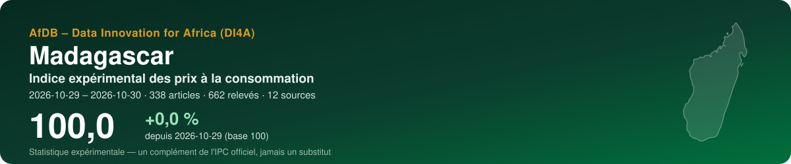
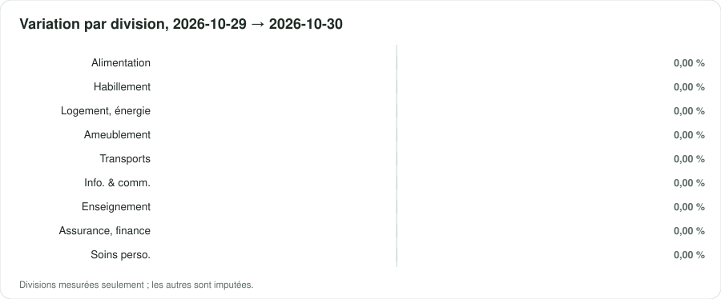
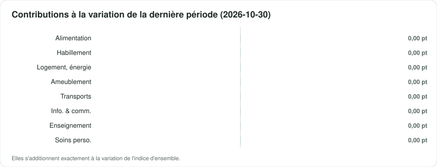

<p align="center"></p>

<p align="center">
  <a href="https://suphermani.github.io/MAKETY_IGICIRO/"><b>▶ Ouvrir le tableau de bord</b></a> · <a href="README.md">English version</a>
</p>

<p align="center">
      
</p>

## En bref

| Indicateur | Valeur |
|---|---|
| **Indice d'ensemble** | **100,0** (+0,0 % depuis 2026-10-29) |
| Variation de la dernière période | +0,00 % |
| Fenêtre | 2026-10-29 → 2026-10-30 · par date de collecte |
| Données | 662 relevés · 338 articles · 12 sources |
| Divisions COICOP mesurées | 8 / 13 |
| Pondérations | officielles — Not found online (two review passes, 2026-10-28). INSTAT's NIPC (base 100 = 2016 average, 12 COICOP 1999 functions) shows a 'Pondération' co |
| Devise | MGA (Ar) |

> [!IMPORTANT]
> Statistique expérimentale construite à partir de prix publiés en ligne (boutiques, régulateurs, services publics, données de marché). Un complément de l'indice officiel des prix de l'institut national de la statistique — jamais un substitut.

<p align="center"></p>

## Messages clés

| Confiance | Message | Pourquoi |
|---|---|---|
| 🟠 Faible | Entre 2026-10-29 et 2026-10-30, l'indice expérimental a varié de +0,0 % (2 périodes, 338 articles). | Des dates de collecte dans un seul mois : un mouvement de court terme, pas encore une tendance mensuelle. |
| 🟡 Moyenne | Sur la dernière période, la plus forte contribution vient de la division 13 (Soins personnels, protection sociale et divers) : +0,00 point de pourcentage. | Les contributions s'additionnent exactement à la variation de l'indice d'ensemble. |
| 🟡 Moyenne | Les divisions mesurées pèsent 92 % du panier officiel. | Être atteint n'est pas être représenté : un groupe peut être suivi par quelques articles en ligne éloignés de ses variétés officielles. Les groupes non mesurés sont imputés par ceux qui le sont. |
| 🟡 Moyenne | Échantillonnage des articles : le dernier indice se situe entre 100,0 et 100,0 dans 90 % de 100 réplications bootstrap. | L'intervalle couvre le choix des articles collectés, pas le biais des prix en ligne face aux prix en magasin. |

## Par division COICOP

<p align="center"></p>

| | Division | Poids % | Articles | Variation % | Contribution, dernière période (pt) |
|---|---|---:|---:|---:|---:|
| 01 | Produits alimentaires et boissons non alcoolisées | — | 52 | 0,00 | 0,000 |
| 02 | Boissons alcoolisées, tabac et stupéfiants | — | — | imputée | — |
| 03 | Articles d'habillement et chaussures | — | 8 | 0,00 | 0,000 |
| 04 | Logement, eau, électricité, gaz et autres combustibles | — | 4 | 0,00 | 0,000 |
| 05 | Meubles, équipements ménagers et entretien courant | — | 4 | 0,00 | 0,000 |
| 06 | Santé | — | — | imputée | — |
| 07 | Transports | — | 18 | 0,00 | 0,000 |
| 08 | Information et communication | — | 128 | 0,00 | 0,000 |
| 09 | Loisirs, sports et culture | — | — | imputée | — |
| 10 | Services d'enseignement | — | 1 | 0,00 | 0,000 |
| 11 | Restaurants et services d'hébergement | — | — | imputée | — |
| 12 | Assurances et services financiers | — | 14 | 0,00 | — |
| 13 | Soins personnels, protection sociale et divers | — | 109 | 0,00 | 0,000 |

*Imputée* : aucun prix lu pour la division ; elle évolue comme les divisions mesurées (Manuel de l'IPC 2020, ch. 6).

<p align="center"></p>

## Sources

19 sources actives au registre, 9 exclues avec leur motif. Chaque requête du robot lit d'abord le robots.txt ; un refus est consigné, jamais contourné.

| Source | Type | COICOP | Statut | Relevés de cette exécution |
|---|---|---|---|---:|
| [KIBO Tananarive — supermarket online shop (drive / delivery)](https://www.kibo.mg/tananarive/) | boutique en ligne | 01, 05, 13 | non vérifiée | 470 |
| [ABCIE — fresh fruit and vegetables, Antananarivo (WooCommerce)](https://www.abcie.org/) | boutique en ligne | 01 | partielle | 116 |
| [BonMarché.mg — online shop (WooCommerce)](https://bonmarche.mg) | boutique en ligne | 01, 02, 05, 08, 09, 13 | partielle | 12 |
| [Orange Madagascar — mobile data bundles](https://newsmada.com/?p=197986) | tarif réglementé | 08 | partielle | 10 |
| [BRED Madagasikara — retail banking fees (conditions tarifaires 2026)](https://bred.mg/wp-content/uploads/2026/03/Affiche-Conditions-Tarifaires-Client-2026-BRED-MADAGASIKARA-MAJ-JAN-2026-V2.1.pdf) | tarif réglementé | 12 | vérifiée | 10 |
| [MVola — mobile-money fee grid of 17/02/2025 (secondary page)](https://blog.iambeezy.app/fr/commission-apport-affaires-rural-net-reel-madagascar-2026/) | tarif réglementé | 12 | partielle | 10 |
| [Yas (ex-Telma) — mobile data bundles](https://blog.iambeezy.app/fr/faire-durer-forfait-data-madagascar-fr-2026/) | tarif réglementé | 08 | partielle | 8 |
| [Orange Money Madagascar — fee grid (secondary page)](https://temovision.com/orange-money-madagascar-grille-tarifaire/) | tarif réglementé | 12 | partielle | 8 |
| [Fuel and lamp kerosene pump prices (OMH / government, national)](https://www.2424.mg/carburant-hausse-de-200-ariary-sur-le-prix-du-petrole-lampant-prix-inchanges-pour-le-gasoil-et-le-supercarburant-au-moins-jusquen-decembre/) | tarif réglementé | 07, 04 | vérifiée | 6 |
| [Vitogaz — domestic LPG (butane) cylinder prices](https://www.madagascar-tribune.com/Hausse-des-prix-du-gaz-et-des.html) | tarif réglementé | 04 | partielle | 6 |
| [Yas (ex-Telma) — home fibre offers](https://newsmada.com/?p=184621) | tarif réglementé | 08 | partielle | 4 |
| [Public university registration fees (Université de Mahajanga)](https://www.lexpress.mg/2025/09/universite-de-mahajanga-inscriptions.html) | tarif réglementé | 10 | partielle | 2 |
| [e-Trano — rental listings, Antananarivo](https://e-trano.com/locations-biens-immobiliers/) | loyers | 04 | partielle | 0 |
| [JIRAMA — household electricity and water tariffs (ORE)](http://www.ore.mg/DonneesTechniques/Tarifs.html) | tarif réglementé | 04 | non vérifiée | 0 |
| [World Bank RTFP — monthly market food price estimates (469 markets)](https://microdata.worldbank.org/catalog/8240) | prix de marché | 01 | partielle | 0 |
| [INSTAT — NIPC monthly file (official CPI, base 2016)](https://www.instat.mg/p/nipc-nouvel-indice-des-prix-a-la-consommation-mars-2026) | référence officielle | — | partielle | 0 |
| [World Bank — official CPI (annual)](https://api.worldbank.org/v2/country/MDG/indicator/FP.CPI.TOTL) | référence officielle | — | partielle | 0 |
| [IMF DataMapper — inflation (WEO)](https://www.imf.org/external/datamapper/api/v1/PCPIPCH/MDG) | référence officielle | — | partielle | 0 |
| [FEWS NET Data Warehouse — Madagascar staple food market prices](https://fews.net/data/markets-and-trade) | prix de marché | 01 | partielle | 0 |

<details><summary>9 sources exclues et pourquoi</summary>

- **Radisson Serviced Apartments Antananarivo — restaurant menu (PDF)** — Carte de restaurant d'hôtel en Ariary, lue le 28/10/2026 : « MIXED SALAD 10 000 », « PLATE OF HOMEMADE FRIES 10 000 », « MARGHERITA PIZZA (V) 30 000 », « CREPES OF YOUR CHOICE (A) 16 000 », « SHRIMP RAMEN (B|D) 42 000 ». Carte non datée : valid_from est la date de lecture, pas une date d'effet. Partiel : segment haut seulement, un seul établissement, fraîcheur inconnue ; gardée en attente pour la division 11 jusqu'à trouver une plateforme de livraison ou une source de cartes plus large (aucune n'est sortie en recherche).
- **Observatoire du Riz (ODR, Ministry of Agriculture) — monthly rice price bulletin** — Bulletin mensuel officiel de la Cellule de l'Observatoire du Riz (MINAE, avec l'équipe des statistiques agricoles) : prix moyens en Ar/kg du paddy et du riz blanc local et importé aux stades producteur, gros et détail, par région (23) et district, issus d'enquêtes de marché. Bulletin N°40, septembre 2024 : paddy, moyenne nationale 1 598 Ar/kg ; paddy Analanjirofo 2 092 Ar/kg ; riz blanc local au détail, Antananarivo Renivohitra 3 158 Ar/kg.
- **Jumia** — Jumia n'opère pas à Madagascar : sa page d'implantations cite l'Égypte, le Ghana, la Côte d'Ivoire, le Kenya, le Maroc, le Nigeria, le Sénégal et l'Ouganda (28/10/2026).
- **OMH — Office Malgache des Hydrocarbures (fuel and LPG prices)** — Le robots.txt a refusé le client d'examen sur toutes les pages (accueil, actualité « Nouveaux prix des carburants », page des prix du gaz CL=prixgaz) : hors limites jusqu'à lecture manuelle. Les prix des carburants viennent de la presse dans mg_fuel_grid.
- **Supermarché.mg — online supermarket** — Le robots.txt a refusé le client d'examen : hors limites jusqu'à lecture manuelle.
- **MesCourses.mg, BestPlace.mg — online grocery (PrestaShop)** — Les deux vendent épicerie et recharges Vitogaz, mais leur robots.txt a refusé le client d'examen sur les fiches produits : hors limites jusqu'à lecture manuelle. Les sources d'épicerie les plus prometteuses si une lecture humaine du robots.txt les autorise.
- **Kapsules.shop** — Le robots.txt a refusé le client d'examen sur la fiche produit (Vitogaz 9 kg).
- **Banky Foiben'i Madagasikara — price statistics** — Le robots.txt a refusé le client d'examen.
- **WFP market prices (HDX)** — Le jeu existe (« Madagascar - Food Prices », CSV 2,0 Mo, fréquence annoncée mensuelle) mais sa période s'arrête au 15 février 2023 et sa dernière modification date du 18 août 2024 (lu le 28/10/2026) : trop ancien pour un indice courant. mg_rtfp (jusqu'en août 2026) le remplace ; à réactiver avec params {dataset: wfp-food-prices-for-madagascar} si le PAM reprend la publication. Approfondissement : les bulletins de marché du PAM pour Madagascar trouvés en ligne s'arrêtent en 2022 (avril et juillet 2022, 38 à 46 marchés du Sud et du Sud-Est) ; aucun de 2025-2026 n'est sorti en recherche.

</details>

## Méthode

Articles appariés ; indices élémentaires de **Jevons** par classe COICOP 2018, points de vente en strates de poids égal ; imputation explicite des prix manquants (deux périodes au plus, onze pour les produits saisonniers) ; remplacements raccordés avec ajustement de quantité ; agrégation avec les poids officiels sous forme **Young/Lowe**, chaînée ; GEKS pour contrôler la dérive de chaînage ; intervalle bootstrap à 90 %. Comme le prescrit le *Manuel de l'indice des prix à la consommation* (FMI et al., 2020). Détails : [docs/METHODOLOGIE.md](docs/METHODOLOGIE.md).

## Données

Copies ouvertes, lisibles par machine, de ce que montre le tableau de bord :

- [`data/index_all_items.csv`](data/index_all_items.csv) — indice d'ensemble par période, avec son intervalle à 90 %
- [`data/index_divisions.csv`](data/index_divisions.csv) — indice de chaque division mesurée
- [`data/contributions.csv`](data/contributions.csv) — contributions des divisions à chaque variation, en points
- [`data/basket.csv`](data/basket.csv) — poids, articles et variation par division
- [`data/sources.csv`](data/sources.csv) — le registre des sources et ce que l'exécution a obtenu de chacune
- [`data/metadata.json`](data/metadata.json) — pays, périodes, pondérations et chiffres clés

## Reproduire

L'indice est produit par la boîte à outils ouverte **cpi-di4a** en deux notebooks : le notebook 1 collecte poliment les prix (robots.txt d'abord, robot identifié) et les scelle dans une archive ; le notebook 2 classe, calcule et publie ce dépôt. Choisissez le code pays, *Exécution → Tout exécuter*.

## Citer

```text
AfDB – Data Innovation for Africa (DI4A) (2026). Indice expérimental des prix à la consommation — Madagascar. https://suphermani.github.io/MAKETY_IGICIRO/
```

Voir aussi [CITATION.cff](CITATION.cff).

---

<p align="center"><sub>AfDB – Data Innovation for Africa (DI4A) · généré le 2026-10-30 · code sous licence MIT ; les données collectées restent soumises aux conditions de chaque source</sub></p>
