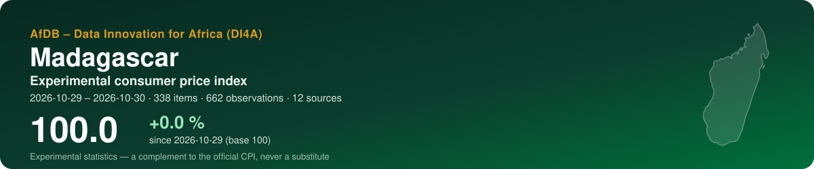
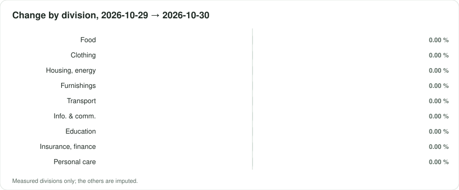
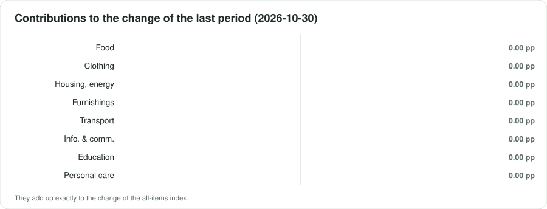

<p align="center"></p>

<p align="center">
  <a href="https://suphermani.github.io/MAKETY_IGICIRO/"><b>▶ Open the live dashboard</b></a> · <a href="README.fr.md">Version française</a>
</p>

<p align="center">
      
</p>

## At a glance

| Indicator | Value |
|---|---|
| **All-items index** | **100.0** (+0.0 % since 2026-10-29) |
| Last period change | +0.00 % |
| Window | 2026-10-29 → 2026-10-30 · by collection date |
| Data | 662 observations · 338 items · 12 sources |
| COICOP divisions measured | 9 / 13 |
| Weights | not supplied — divisions weighted equally — Not found online (two review passes, 2026-10-28). INSTAT's NIPC (base 100 = 2016 average, 12 COICOP 1999 functions) shows a 'Pondération' co |
| Currency | MGA (Ar) |

> [!IMPORTANT]
> Experimental statistics built from prices published online (shops, regulators, utilities, market data). A complement to the official consumer price index of the national statistics office — never a substitute.

<p align="center"></p>

## Key messages

| Confidence | Message | Why |
|---|---|---|
| 🟠 Low | Between 2026-10-29 and 2026-10-30, the experimental index moved by +0.0 % (2 periods, 338 items). | Collection dates within a single month: a short-term movement, not yet a monthly trend. |
| 🟡 Medium | Over the last period, the largest contribution comes from division 13 (Personal care, social protection and miscellaneous): +0.00 percentage point. | Contributions add up exactly to the change of the all-items index. |
| 🟠 Low | Divisions are weighted equally: no official weights were supplied. | The index is a trend indicator, not comparable to the national CPI. |
| 🟡 Medium | Sampling of items: the latest index lies between 100.0 and 100.0 in 90 % of 100 bootstrap replications. | The interval covers which items were collected, not the bias of online prices against shop prices. |

## By COICOP division

<p align="center"></p>

| | Division | Weight % | Items | Change % | Contribution, last period (pp) |
|---|---|---:|---:|---:|---:|
| 01 | Food and non-alcoholic beverages | — | 52 | 0.00 | 0.000 |
| 02 | Alcoholic beverages, tobacco and narcotics | — | — | imputed | — |
| 03 | Clothing and footwear | — | 8 | 0.00 | 0.000 |
| 04 | Housing, water, electricity, gas and other fuels | — | 4 | 0.00 | 0.000 |
| 05 | Furnishings, household equipment and maintenance | — | 4 | 0.00 | 0.000 |
| 06 | Health | — | — | imputed | — |
| 07 | Transport | — | 18 | 0.00 | 0.000 |
| 08 | Information and communication | — | 128 | 0.00 | 0.000 |
| 09 | Recreation, sport and culture | — | — | imputed | — |
| 10 | Education services | — | 1 | 0.00 | 0.000 |
| 11 | Restaurants and accommodation services | — | — | imputed | — |
| 12 | Insurance and financial services | — | 14 | 0.00 | 0.000 |
| 13 | Personal care, social protection and miscellaneous | — | 109 | 0.00 | 0.000 |

*Imputed*: no price was read for the division; it moves with the measured ones (CPI Manual 2020, ch. 6).

<p align="center"></p>

## Sources

19 active sources in the register, 9 excluded with their reason. Every robot request reads robots.txt first; a refusal is recorded, never circumvented.

| Source | Type | COICOP | Status | Observations this run |
|---|---|---|---|---:|
| [KIBO Tananarive — supermarket online shop (drive / delivery)](https://www.kibo.mg/tananarive/) | online shop | 01, 05, 13 | unverified | 470 |
| [ABCIE — fresh fruit and vegetables, Antananarivo (WooCommerce)](https://www.abcie.org/) | online shop | 01 | partial | 116 |
| [BonMarché.mg — online shop (WooCommerce)](https://bonmarche.mg) | online shop | 01, 02, 05, 08, 09, 13 | partial | 12 |
| [Orange Madagascar — mobile data bundles](https://newsmada.com/?p=197986) | regulated tariff | 08 | partial | 10 |
| [BRED Madagasikara — retail banking fees (conditions tarifaires 2026)](https://bred.mg/wp-content/uploads/2026/03/Affiche-Conditions-Tarifaires-Client-2026-BRED-MADAGASIKARA-MAJ-JAN-2026-V2.1.pdf) | regulated tariff | 12 | verified | 10 |
| [MVola — mobile-money fee grid of 17/02/2025 (secondary page)](https://blog.iambeezy.app/fr/commission-apport-affaires-rural-net-reel-madagascar-2026/) | regulated tariff | 12 | partial | 10 |
| [Yas (ex-Telma) — mobile data bundles](https://blog.iambeezy.app/fr/faire-durer-forfait-data-madagascar-fr-2026/) | regulated tariff | 08 | partial | 8 |
| [Orange Money Madagascar — fee grid (secondary page)](https://temovision.com/orange-money-madagascar-grille-tarifaire/) | regulated tariff | 12 | partial | 8 |
| [Fuel and lamp kerosene pump prices (OMH / government, national)](https://www.2424.mg/carburant-hausse-de-200-ariary-sur-le-prix-du-petrole-lampant-prix-inchanges-pour-le-gasoil-et-le-supercarburant-au-moins-jusquen-decembre/) | regulated tariff | 07, 04 | verified | 6 |
| [Vitogaz — domestic LPG (butane) cylinder prices](https://www.madagascar-tribune.com/Hausse-des-prix-du-gaz-et-des.html) | regulated tariff | 04 | partial | 6 |
| [Yas (ex-Telma) — home fibre offers](https://newsmada.com/?p=184621) | regulated tariff | 08 | partial | 4 |
| [Public university registration fees (Université de Mahajanga)](https://www.lexpress.mg/2025/09/universite-de-mahajanga-inscriptions.html) | regulated tariff | 10 | partial | 2 |
| [e-Trano — rental listings, Antananarivo](https://e-trano.com/locations-biens-immobiliers/) | rents | 04 | partial | 0 |
| [JIRAMA — household electricity and water tariffs (ORE)](http://www.ore.mg/DonneesTechniques/Tarifs.html) | regulated tariff | 04 | unverified | 0 |
| [World Bank RTFP — monthly market food price estimates (469 markets)](https://microdata.worldbank.org/catalog/8240) | market prices | 01 | partial | 0 |
| [INSTAT — NIPC monthly file (official CPI, base 2016)](https://www.instat.mg/p/nipc-nouvel-indice-des-prix-a-la-consommation-mars-2026) | official benchmark | — | partial | 0 |
| [World Bank — official CPI (annual)](https://api.worldbank.org/v2/country/MDG/indicator/FP.CPI.TOTL) | official benchmark | — | partial | 0 |
| [IMF DataMapper — inflation (WEO)](https://www.imf.org/external/datamapper/api/v1/PCPIPCH/MDG) | official benchmark | — | partial | 0 |
| [FEWS NET Data Warehouse — Madagascar staple food market prices](https://fews.net/data/markets-and-trade) | market prices | 01 | partial | 0 |

<details><summary>9 excluded sources and why</summary>

- **Radisson Serviced Apartments Antananarivo — restaurant menu (PDF)** — Hotel restaurant menu in Ariary, read on 28/10/2026: 'MIXED SALAD 10 000', 'PLATE OF HOMEMADE FRIES 10 000', 'MARGHERITA PIZZA (V) 30 000', 'CREPES OF YOUR CHOICE (A) 16 000', 'SHRIMP RAMEN (B|D) 42 000'. The menu is undated: valid_from is the date it was read, not an effective date. Partial: upper segment only, one outlet, freshness unknown; kept as a placeholder for division 11 until a food-delivery platform or a broader menu source is found (none surfaced in search).
- **Observatoire du Riz (ODR, Ministry of Agriculture) — monthly rice price bulletin** — Official monthly bulletin of the Cellule de l'Observatoire du Riz (MINAE, with the agricultural statistics team): average prices in Ar/kg of paddy and of local and imported white rice at producer, wholesale and retail level, by region (23) and district, from market surveys. Bulletin N°40, September 2024: paddy national average 1 598 Ar/kg; paddy Analanjirofo 2 092 Ar/kg; local white rice retail, Antananarivo Renivohitra 3 158 Ar/kg.
- **Jumia** — Jumia does not operate in Madagascar: its locations page lists Egypt, Ghana, Ivory Coast, Kenya, Morocco, Nigeria, Senegal and Uganda (28/10/2026).
- **OMH — Office Malgache des Hydrocarbures (fuel and LPG prices)** — robots.txt refused the review fetcher on every page (home, news 'Nouveaux prix des carburants', LPG price page CL=prixgaz): off-limits until read by hand. Fuel prices come from the press in mg_fuel_grid.
- **Supermarché.mg — online supermarket** — robots.txt refused the review fetcher: off-limits until read by hand.
- **MesCourses.mg, BestPlace.mg — online grocery (PrestaShop)** — Both list groceries and Vitogaz refills, but their robots.txt refused the review fetcher on product pages: off-limits until read by hand. The most promising grocery sources if a human reading of robots.txt allows them.
- **Kapsules.shop** — robots.txt refused the review fetcher on the product page (Vitogaz 9 kg).
- **Banky Foiben'i Madagasikara — price statistics** — robots.txt refused the review fetcher.
- **WFP market prices (HDX)** — The dataset exists ('Madagascar - Food Prices', CSV 2.0 MB, stated frequency monthly) but its time period ends on 15 February 2023 and it was last modified on 18 August 2024 (read 28/10/2026): too stale for a current index. mg_rtfp (to August 2026) takes its place; re-activate with params {dataset: wfp-food-prices-for-madagascar} if WFP resumes publication. Deepening pass: WFP's own Madagascar market bulletins found online stop in 2022 (April and July 2022, 38-46 markets in the South and South-East); none from 2025-2026 surfaced.

</details>

## Method

Matched items; elementary **Jevons** indices by COICOP 2018 class, outlets as equal-weight strata; explicit imputation of missing prices (two periods at most, eleven for seasonal items); replacements linked with a quantity adjustment; aggregation with official weights in the **Young/Lowe** form, chained; GEKS as a chain-drift check; a 90 % bootstrap interval. As prescribed by the *Consumer Price Index Manual: Concepts and Methods* (IMF et al., 2020). Details: [docs/METHODOLOGY.md](docs/METHODOLOGY.md).

## Data

Open, machine-readable copies of what the dashboard shows:

- [`data/index_all_items.csv`](data/index_all_items.csv) — all-items index by period, with its 90 % interval
- [`data/index_divisions.csv`](data/index_divisions.csv) — index of each measured division
- [`data/contributions.csv`](data/contributions.csv) — contributions of the divisions to each change, in percentage points
- [`data/basket.csv`](data/basket.csv) — weights, items and change by division
- [`data/sources.csv`](data/sources.csv) — the source register and what this run obtained from each source
- [`data/metadata.json`](data/metadata.json) — country, periods, weights and key figures

## Reproduce

The index is produced by the open toolkit **cpi-di4a** in two notebooks: notebook 1 collects prices politely (robots.txt first, identified robot) and seals them in an archive; notebook 2 classifies, computes and publishes this repository. Set the country code, *Runtime → Run all*.

## Cite

```text
AfDB – Data Innovation for Africa (DI4A) (2026). Experimental consumer price index — Madagascar. https://suphermani.github.io/MAKETY_IGICIRO/
```

See also [CITATION.cff](CITATION.cff).

---

<p align="center"><sub>AfDB – Data Innovation for Africa (DI4A) · generated on 2026-10-30 · code under MIT licence; collected data remain subject to each source's terms</sub></p>
